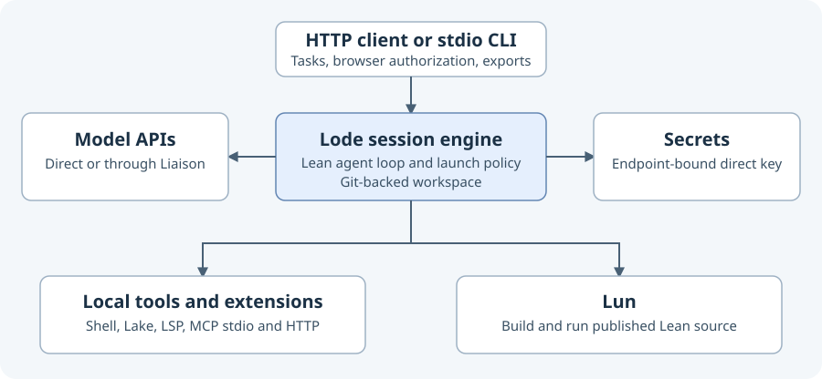

# The Lean coding agent

Lode runs a model-driven session against a Git-backed workspace. The HTTP
server, the native stdio command, and compiled extensions share the Lean
session loop. File tools operate under the checkout capability, shell
commands run as bounded subprocesses, `check` builds Lake targets, and `lsp`
returns Lean diagnostics, hovers, definitions, goals, and completions. Run
one container per trust domain because project code and shell commands run
with the container's privileges. For an application that follows a server
session over HTTP, see the Python client and scripted examples.
[`Lode/Session.lean`](../../Lode/Session.lean), [`Lode/ToolPolicy.lean`](../../Lode/ToolPolicy.lean),
[`Lode/Lsp.lean`](../../Lode/Lsp.lean), [`Examples/client.py`](../../Examples/client.py),
[Pi's extension API](https://github.com/earendil-works/pi/blob/main/packages/coding-agent/docs/extensions.md).



## Operator settings

Both `lode serve --settings FILE` and `lode run --settings FILE` accept TOML
or JSON. A flag selects the file ahead of `LODE_SETTINGS`. Environment
variables override individual settings. Use an operator-owned file and mount
it read-only in a container. Without a selected file, Lode uses environment
variables and built-in defaults. `lode run --config FILE` still selects a
session request.

```toml
toolchain = "leanprover/lean4:v4.36.0"
linenRev = "bcfec9a81d6e738ecb273f89e2102b4712d8e160"
port = 8080

[model]
provider = "scaleway"
name = "MODEL_ID"

[secrets]
baseUrl = "https://secrets.example.org"
modelKeyPath = "lode/model-keys/scaleway"
```

JSON uses the same keys with `model` and `secrets` as nested objects. The
complete field list and environment overrides are in the README. The
toolchain and Linen settings guide new source generation. An existing
project continues to compile with its own `lean-toolchain` and package lock.
[`Lode/Settings.lean`](../../Lode/Settings.lean), [configuration](../../README.md#configuration).

## Models and credentials

| Operator preset | Default protocol | Default API base |
| --- | --- | --- |
| `openai` | Responses or Chat Completions, according to model ID | `https://api.openai.com/v1` |
| `anthropic` | Messages | `https://api.anthropic.com/v1` |
| `scaleway` | Chat Completions | `https://api.scaleway.ai/v1` |
| `baseten` | Chat Completions | `https://inference.baseten.co/v1` |

The operator can set `model.api` and `model.baseUrl` for a compatible
deployment. For direct inference, Lode selects the manual session key,
the session's OAuth bearer, a startup API key, or the current record at
the configured Secrets KV path.
Vault requests use `LODE_SECRETS_TOKEN` and verify the record's model base
URL before using its key. To create a version in the vault, pass
`LODE_MODEL_API_KEY` in the environment and run
`lode secrets store-model-key --settings FILE --yes`. Use `--dry-run` to
inspect the destination. Restart a vault-backed process with the startup
API key unset to let it read current vault versions. [Scaleway Chat API](https://www.scaleway.com/en/docs/generative-apis/api-cli/using-chat-api/),
[Baseten Chat Completions](https://www.baseten.co/resources/changelog/deepseek-v41-flash-available-on-baseten/),
[`Lode/Secrets.lean`](../../Lode/Secrets.lean).

An authenticated HTTP client receives `modelKeyUrl` in eligible session
status responses. Send a `PUT` with `{"apiKey":"…"}` to set or rotate the
memory-only key, or `{"apiKey":null}` to clear it. A terminal launcher can
prompt for the key and send this request through loopback or TLS. A model
warrant takes precedence. The app can replace short-lived warrants through
`PUT /v0/sessions/{id}/credentials`. Liaison can refresh supported upstream
OAuth credentials while servicing an operation. [`Lode/Server.lean`](../../Lode/Server.lean),
[Liaison credential formats](https://github.com/typednotes/liaison#credential-formats).

### Browser OAuth

Configure a single issuer whose access token is accepted by the configured
Chat Completions or Responses endpoint. Register the exact redirect URI at
the issuer and route it to Lode's HTTP server.

```toml
[modelOAuth]
authorizationUrl = "https://identity.example.org/oauth/authorize"
tokenUrl = "https://identity.example.org/oauth/token"
redirectUri = "https://lode.example.org/v0/model-oauth/callback"
clientId = "lode"
scope = "inference offline_access"
```

Supply `LODE_TOKEN` to protect the API and `LODE_OAUTH_CLIENT_SECRET` when
the issuer uses a confidential client with form-based token authentication.
For local testing, use a loopback redirect and `allowLocal = true`. Map a
container port to loopback when the client and callback run on the same
machine.

A caller sends an authenticated `POST` to the session's `modelOAuthUrl`
and opens the returned `authorizationUrl` in the browser. From a terminal,
`lode oauth BASE_URL ID` prints this URL and `--open` opens it locally.
The launcher uses `LODE_TOKEN` to authorize the request. Lode consumes
the callback state once and exchanges the code with the PKCE S256 verifier.
Poll the session's `modelOAuthConnected` field, then send the task. Lode
refreshes the access token near expiry and replaces a rotated refresh token
in memory. Browser OAuth does not affect session identity or permissions.
Typednotes integration and live provider SSO qualification remain open.
[`Lode/OAuth.lean`](../../Lode/OAuth.lean),
[PKCE](https://www.rfc-editor.org/rfc/rfc7636.html),
[OAuth security BCP](https://www.rfc-editor.org/rfc/rfc9700.html).

## Compiled tools and MCP

`Lode.Extension.Tool.define` couples a JSON decoder to a Lean argument type
and its handler. Select the tool list when compiling the executable and
pass `Lode.Extension.Catalog.check tools` to `Lode.App.main`. The standard
binary includes `lean_version`, which runs `lake env lean --version` in the
project. The launch request must explicitly include `"extension"` in `tools`
and the build agent invokes it with `{"name":"lean_version","arguments":{}}`.
The live policy can remove access just like a built-in tool.
[`Main.lean`](../../Main.lean), [`Lode/Extension.lean`](../../Lode/Extension.lean),
[`Lode/Extensions/Lean.lean`](../../Lode/Extensions/Lean.lean).

`Lode.Mcp.stdioTool` fixes the command, process arguments and server-side
tool name for a subprocess that sends one response per request.
`Lode.Mcp.httpTool` fixes an HTTP endpoint, optional bearer and tool name.
It discovers up to eight pages of tools before calling the selected name,
accepts JSON and finite SSE responses, and closes a negotiated session on
exit. In finite SSE replies Lode skips notifications and rejects reverse
requests. `Lode.Mcp.listHttpTools` exposes discovery to trusted compiled
code. Registration and argument validation remain in the compiled catalog.
Persistent SSE, resume and brokered MCP are tracked in TODO.
[`Lode/Mcp.lean`](../../Lode/Mcp.lean), [`test/McpSmoke.lean`](../../test/McpSmoke.lean),
[MCP lifecycle](https://modelcontextprotocol.io/specification/2025-11-25/basic/lifecycle),
[MCP transports](https://modelcontextprotocol.io/specification/2025-11-25/basic/transports).

## Cell sources and native packages

A cell revision identifies four immutable records: natural-language intent,
approved platform constraints, the Lean contract, and implementation source
pinned in Git. Typednotes owns the intent and approved constraints. Lode
writes the Lean contract and implementation, and checks them with Lake and
the language server. Lun checks the published implementation against the
contract and builds the native code. A dependent contract can express, for
example, that a function returns a `Vector` whose length is the number of
items in its input. Lun's current outer wire interface uses independent
input and output types. An input-indexed output needs a wire adapter that
decodes and retains the input witness. [Typednotes cell package design](https://github.com/typednotes/typednotes/blob/main/docs/cell-packages.md),
[the five layers](https://github.com/typednotes/typednotes/blob/main/docs/diagrams/cell-package-layers.svg).

### Local native artifact manifests

The operator can create and verify a manifest for an existing native payload.
The identity JSON supplies `intentSha256`, `constraintsSha256`,
`contractSha256`, `source` (`repository`, `commit`, optional `project`,
`module`, `declaration`), `leanToolchain`, `target` and `runtimeAbi`. For payload bytes
$B$, Lode records $d=\operatorname{SHA256}(B)$ and the byte count. OpenPGP
signs the exact manifest bytes. Use a provisioned GnuPG keyring for the
private key and an explicit verification keyring for accepted signers.

```sh
lode cell manifest identity.json cell.payload > manifest.json
lode cell sign manifest.json cell.payload --key "$SIGNING_FINGERPRINT" > manifest.asc
lode cell verify manifest.json cell.payload --signature manifest.asc --keyring compiler.gpg
tar -czf cell.tgz manifest.json manifest.asc cell.payload
```

The signed identity is a producer declaration. Lun still needs to attest
the checked source and compiled payload, verify the signature and ABI at
admission, and enforce fresh authority for each run. The shared transport
archive and content-addressed storage contract are open work.
The addition example builds a native static library from a published Git
commit, verifies its manifest and runs a separate consumer. [`Lode/Cell.lean`](../../Lode/Cell.lean),
[addition example](../../Examples/cell-addition/README.md),
[GnuPG signature verification](https://www.gnupg.org/documentation/manuals/gnupg/gpgv.html).

### Shared cell package and invocation

Linen's `System.Cell` defines the v2 manifest, verified package and typed call
interface. `lode output` defaults to that package. The operator can build a
published Lake target and sign it with a compiler record, or supply a package
with an independently trusted manifest pin, runtime profile and compiler
keyring. Lode binds the package to the session's published repository, commit
and project before writing the result.

The same session export can build a Lake executable from the published
project snapshot, archive the tracked project files, or report the immutable
Git coordinates. Work in the checkout must be published first. Cell signing
is an explicit compiler step. A configured compiler can package its checked
worker now, and direct integration with Lun's compiler is tracked in TODO.
[Cell output and build records](../cell-output.md).

## Verification

Use `lake build --wfail` and `lake test` for contracts in Lean. Run
`python3 test/settings.py` to exercise a real service, a temp Git repository,
Secrets rotation, both startup formats, browser OAuth, and direct key handoff.
Run `lake exe lode-mcp-smoke` and `python3 test/mcp_http.py` for MCP, and
`python3 test/cell_artifact.py` for manifest and OpenPGP checks. The existing CLI, LSP,
mock Liaison and Lun integration suites cover the remaining current paths.
`python3 test/pi_parity.py` compares tool execution, result replay and
session resume with Pi against a shared scripted localhost provider. Live
provider SSO conformance remains open. [Test commands](../../README.md#test).
